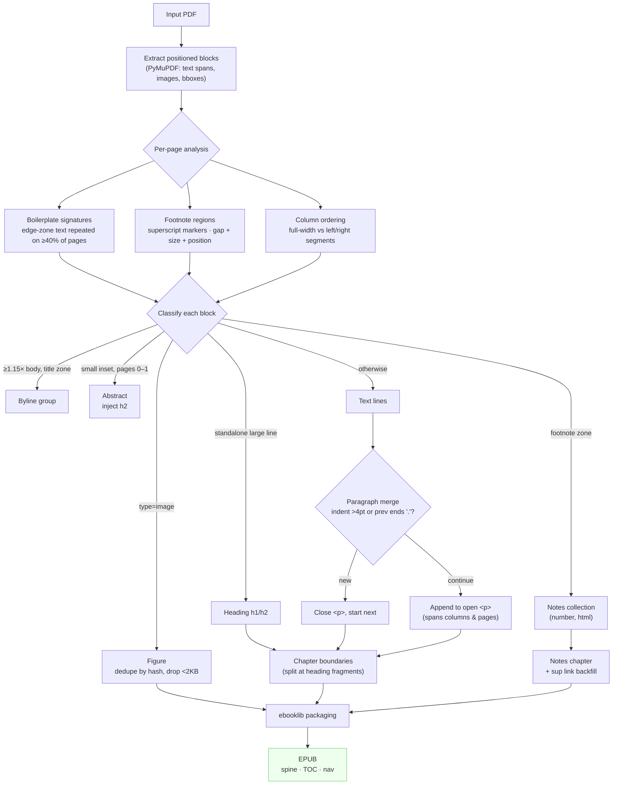

# Conversion Pipeline

How `pdf_to_epub.py` turns a PDF into a structured EPUB.

## Detection signals

| Element | Signal |
|---|---|
| Body font size | Modal span size across the document |
| Line height | Median line bbox height |
| h1 | span size ≥ 1.6× body |
| h2 | standalone single-line block ≥ 1.08× body, no mid-string `.` |
| Byline | block median ≥ 1.15× body + short single-line followers |
| Abstract | median in (0.75–0.92)× body, inset margins, pages 0–1 |
| Footnote | opens with superscript digit in lower 45% of page |
| Unnumbered note | bottom 40%, median <0.95× body, gap >2× line height |
| Header/footer | short text in page edge zones on ≥40% of pages |
| New paragraph | first-line indent >4pt, or previous line ends `.`/`!`/`?` |
| Column split | block crosses page midline = full-width; else L/R by center |
