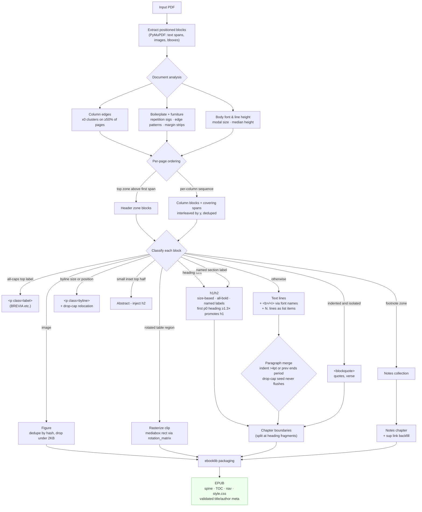

# Conversion Pipeline

How `pdf_to_epub.py` turns a PDF into a structured EPUB.

## Detection signals

| Element | Signal |
|---|---|
| Body font size | Modal span size across the document |
| Line height | Median line bbox height |
| Column edges | x0 clusters found on ≥50% of pages |
| Full-width span | block crosses a gutter between column edges |
| Top zone | blocks fully above the first spanning element |
| h1 | single-line ≥1.6× body, multi-line block all-lines ≥1.6×, or first p0 heading ≥1.3× (promoted) |
| h2 | standalone ≥1.08× body, or all-bold line/block ≥0.9× body outside edge zones that precedes body-flow text in its column (a heading terminates the follower scan; demotion silences bold-band lines per line and in mixed blocks, though a demoted block's ≥1.3× lines may still emit; the scan is column- and page-local so a column- or page-final bold line stays demoted); no sentence periods, no `*†‡§` opener |
| Section label | `References`, `Supporting Online Material`, `Methods`, … at block start → h2 (respects bold-gate demotion — `Funding …` tails are notes) |
| Top label | all-caps short text in top 12% of page → `
` |
| Byline | median ≥1.15× body, or directly after h1 + name-like (` and `/`,`); short single-line followers merge; trailing drop-cap letter relocates into the paragraph |
| Abstract | median in (0.75–0.92)× body, inset margins, top half of page 0–1 |
| Footnote | opens with superscript digit in lower 45% of page |
| Unnumbered note | bottom 40% + gap >2× line height + <0.95× body, OR acknowledgment opener in bottom 55% |
| Page number | pure-digit block in outer 7% edge → dropped |
| List item | line starting `N.`/`N)` → `
`; absorbs continuation lines |
| Blockquote | block indented >12pt from column edge AND isolated (gap >0.7× line height both sides; kept furniture doesn't count as a neighbor) |
| Rotated table | ≥3 tall-narrow blocks sharing a y-band → region rasterized; clip mapped mediabox→displayed via `page.rotation_matrix` |
| Header/footer | signature repeated on ≥40% of pages in edge zone (set built at any doc length; under `--keep-headers` matches flag `is_furniture`) |
| Furniture | pattern (`VOL`, `www.`, `ISSN`, `doi`, `©`, dates) in outer 7% edge; under `--keep-headers` flagged `is_furniture` and emitted verbatim at page edges — inert to classifiers, ordering machinery, and table regions |
| Margin strip | <25pt wide, >4× tall, in outer 10% margin (rotated sidebars) |
| New paragraph | first-line indent >4pt, or previous line ends `.`/`!`/`?` |
| Drop-cap | single uppercase fragment (not `I`/`A`) + lowercase text → joined |
| Bold | flags bit 16, or font name `.B`/`Bold` suffix |
| Italic | font name `.I`/`Italic`/`Oblique` suffix |
| Metadata title | must contain letters, not pagination junk → h1/filename fallback |
| Metadata author | invalid/empty → byline text fallback |
